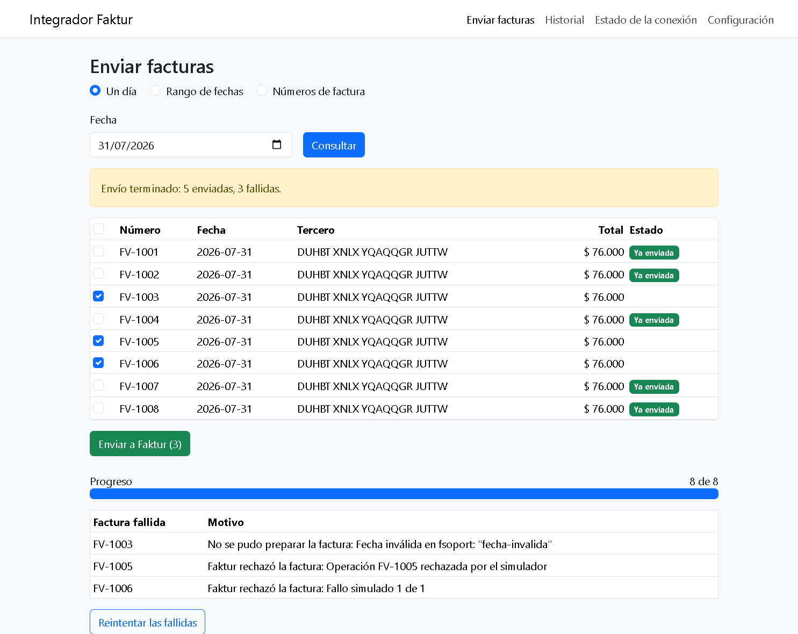
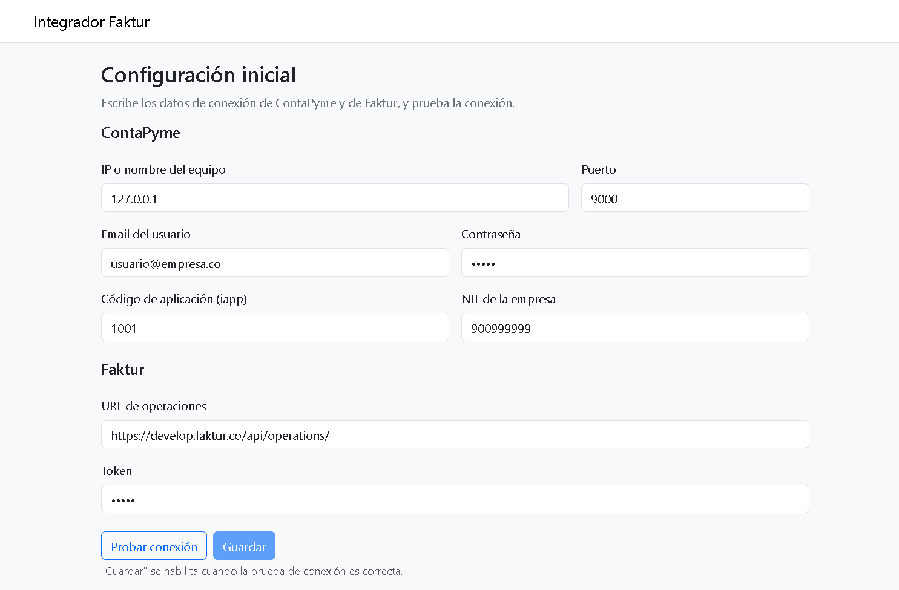
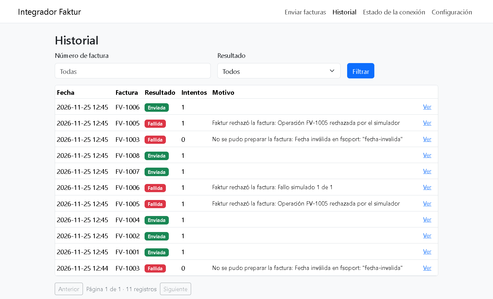
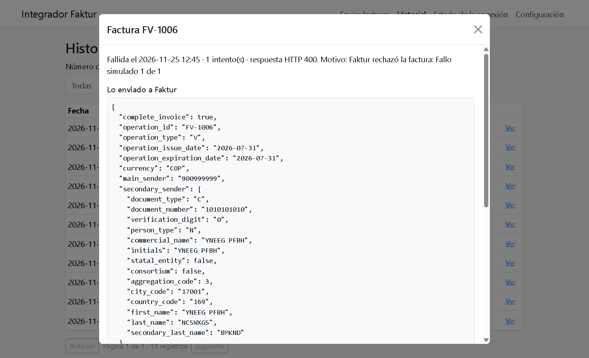
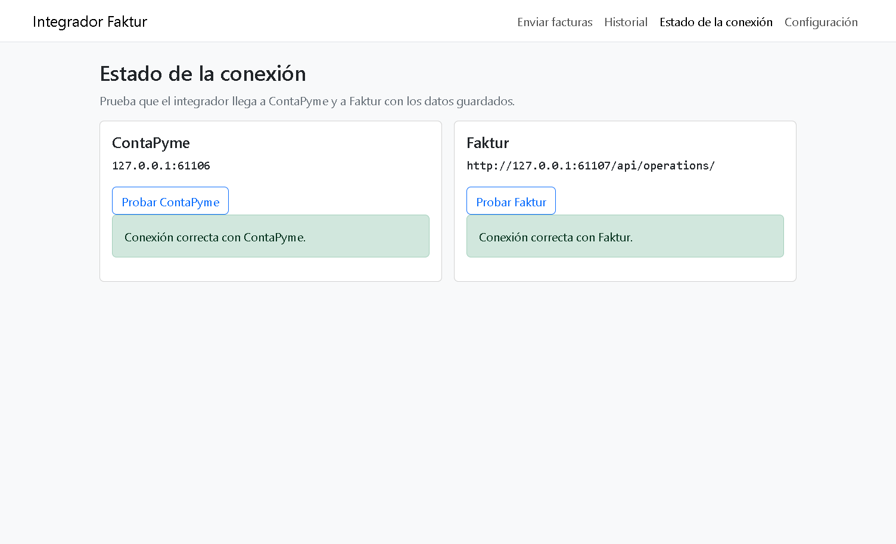

# Integrador de facturas ContaPyme → Faktur

Aplicación local para Windows que lee las facturas de venta del ERP **ContaPyme**, las convierte al
formato de **Faktur** y se las envía. Se instala en el mismo equipo que ContaPyme, se configura desde su
propia pantalla y se usa desde el navegador cuando el usuario lo decide: sin WordPress, sin tareas
programadas y sin Docker.



## Qué hace

- **Configuración desde el navegador.** IP y puerto de ContaPyme, usuario, `iapp`, NIT y token de Faktur
  se escriben una vez y se guardan en SQLite. Solo se pueden guardar si la prueba de conexión pasa.
- **Consulta de facturas** por día, por rango de fechas o por números de factura, con las ya enviadas
  marcadas.
- **Envío a demanda.** El usuario elige las facturas y el envío corre en segundo plano con barra de
  progreso. Una factura con problemas falla sola, con su motivo, y las demás siguen.
- **Reintento** de las fallidas con un botón.
- **Historial** de todos los envíos, con lo que se mandó y lo que respondió Faktur.
- **Estado de la conexión**, con una prueba para ContaPyme y otra para Faktur.

## Cómo funciona

```
Navegador ──► Integrador (Node.js + Express, solo en 127.0.0.1:4000)
                 ├──► Agente ContaPyme  http://<ip>:<puerto>/datasnap/rest/   (solo lectura)
                 ├──► SQLite: configuración + bitácora de envíos (un solo archivo)
                 └──► HTTPS ──► Faktur  /api/operations/
```

1. **Consultar**: el integrador inicia sesión en el agente REST de ContaPyme y pide la lista de
   facturas (`GetListaOperaciones`), página por página.
2. **Enviar**: por cada factura elegida pide el detalle (`DoExecuteOprAction`) y los datos del comprador
   (`GetInfoTercero`), arma el payload de Faktur y lo envía (`POST /api/operations/`). Ante fallos de red
   o de servidor reintenta hasta 3 veces.
3. **Registrar**: cada resultado queda en la bitácora con el número real de intentos y la hora de
   Bogotá. Esa bitácora es la que marca las facturas como "Ya enviada".

**ContaPyme es de solo lectura**: el integrador consulta y nunca modifica el ERP.

## Requisitos

- Windows 10 u 11.
- [Node.js](https://nodejs.org) 22 o 24 (si falta, `instalar.ps1` lo instala en la carpeta).
- Acceso al agente REST de ContaPyme (normalmente en el mismo equipo) y salida HTTPS hacia Faktur.

## Instalación y arranque

Una sola vez, desde la carpeta del integrador (por ejemplo `C:\IntegradorFaktur`):

```powershell
powershell -ExecutionPolicy Bypass -File instalar.ps1
```

Usa Node.js 22 o 24 si el equipo lo tiene; si no, descarga Node 24 LTS portátil de nodejs.org en
`node\` (comprobando su SHA-256, sin permisos de administrador). Después ejecuta `npm ci` y crea el
acceso directo **"Integrador Faktur"** en el escritorio.
Ese acceso directo abre `iniciar.bat`: arranca el integrador y abre **http://localhost:4000** en el
navegador; si ya estaba abierto, solo abre el navegador. Mientras se usa, la ventana del integrador debe
quedar abierta (se puede minimizar).

Opcionalmente, `servicio.ps1` lo instala como **servicio de Windows** con
[WinSW](https://github.com/winsw/winsw) 2.12.0 (comprobado por SHA-256): arranca con el equipo, se
reinicia si falla y escribe sus logs en `logs\servicio`. Pide administrador; `servicio.ps1 -Quitar` lo
desinstala. El acceso directo sigue sirviendo: con el servicio corriendo, solo abre el navegador.

La guía para el cliente, con la instalación, el uso diario y la copia de seguridad, está en
[GUIA.md](GUIA.md). En desarrollo también se puede arrancar con `npm run manual`, que lee `.env`.

Variables de entorno opcionales:

| Variable | Para qué | Por defecto |
|---|---|---|
| `PORT` | Puerto de la interfaz (siempre en `127.0.0.1`) | `4000` |
| `DATOS_DIR` | Carpeta del archivo `integrador.sqlite` | `./datos` |
| `LOGS_DIR` | Carpeta de los logs | `./logs` |
| `CONTAPYME_PUERTO_LOCAL` | Puerto donde se busca el agente en este equipo la primera vez | `9000` |

## Uso

### Primera configuración

La primera vez, toda la app lleva a este asistente. Si encuentra el agente de ContaPyme en el mismo
equipo, rellena la IP y el puerto. **Probar conexión** inicia sesión de verdad y hace una consulta de
prueba; **Guardar** solo se habilita si esa prueba pasa.



Después se puede cambiar desde **Configuración**: la contraseña y el token aparecen ocultos, y si se
dejan vacíos se conservan los guardados. El mismo programa sirve para pruebas y producción: solo cambian
la URL y el token de Faktur.

### Enviar facturas

1. Elige **Un día**, **Rango de fechas** o **Números de factura** y pulsa **Consultar**. Una entrada
   inválida se marca antes de consultar.
2. En la lista, las **ya enviadas** aparecen marcadas y desmarcadas por defecto. Elige las que quieras y
   pulsa **Enviar a Faktur**. Si eliges alguna ya enviada, pide confirmación.
3. Sigue el progreso ("5 de 8"). Al terminar verás cuántas llegaron bien y la tabla de fallidas con su
   motivo.
4. Pulsa **Reintentar las fallidas** para reenviar solo esas.

Mientras hay un envío en curso no se puede consultar ni enviar otra vez, y el servidor rechaza mandar la
misma factura dos veces a la vez.

### Historial

Todos los envíos, filtrables por número de factura y por resultado. **Ver** abre lo que se envió a
Faktur y lo que respondió.





### Estado de la conexión

Muestra a qué ContaPyme y a qué Faktur apunta la configuración, con un botón de prueba para cada uno.
La prueba de Faktur no crea ni lista operaciones: solo comprueba la URL y el token.



## Datos y copia de seguridad

Toda la información vive en **un solo archivo**: `datos/integrador.sqlite`, con la configuración y la
bitácora de envíos. Para hacer una copia de seguridad, cierra el integrador y copia la carpeta `datos`
entera (junto al `.sqlite` pueden quedar `-wal` y `-shm` con los últimos cambios). Los logs técnicos van
a `logs/` y rotan cada día. Las dos carpetas viven dentro de la de instalación: no la borres al
reinstalar.

## Seguridad

- La interfaz escucha **solo en `127.0.0.1`**: no es accesible desde otros equipos de la red.
- No hay credenciales en el código: viven en SQLite y se escriben desde la pantalla de configuración. La
  contraseña de ContaPyme se guarda en MD5, que es lo que pide el agente.
- El filtro que se envía a ContaPyme se construye solo con valores validados (fechas `AAAA-MM-DD` y
  números con letras, dígitos y guiones), nunca con texto libre.
- Los errores se muestran en lenguaje del usuario, sin detalles técnicos.

## Pruebas

```powershell
npm test
```

Las pruebas no necesitan red: ContaPyme y Faktur se simulan en local (`test/simuladores/`) y el
integrador se arranca como proceso real. Cada prueba lleva el id de la subtarea que comprueba. Una
"puerta" en `package.json` (`config.etapa`) marca hasta qué etapa son obligatorias; las de etapas
posteriores se ejecutan pero se informan como TODO.

El **CI** (GitHub Actions, `.github/workflows/pruebas.yml`) ejecuta `npm test` en Windows con Node 22
y 24 en cada push y en cada pull request. Un cambio entra a `main` solo por PR con el CI en verde.

El contrato HTTP que fijan las pruebas está en [`test/README.md`](test/README.md).

## Estructura

| Archivo / carpeta | Qué contiene |
|---|---|
| `importador_facturas_manual.mjs` | Servidor Express: sirve la interfaz y monta las rutas |
| `api.mjs` | Cliente de ContaPyme, transformación al formato de Faktur y envío con reintentos |
| `filtro.mjs` | Construye el filtro de la consulta a partir de valores validados |
| `envios.mjs`, `envios.routes.mjs` | Consulta (`/api/facturas`) y envíos en segundo plano (`/api/envios`) |
| `configuracion.mjs`, `config.routes.mjs` | Configuración en SQLite (`/api/config`) |
| `estado.routes.mjs` | Estado y pruebas de conexión (`/api/estado`) |
| `facturaLogs.*.mjs` | Bitácora de envíos e historial (`/logs/facturas`) |
| `datos.mjs`, `logger.mjs` | Base SQLite única y logs con rotación diaria |
| `public/` | Interfaz (HTML, JS y Bootstrap servido en local) |
| `test/` | Pruebas por etapa, simuladores y ayudas |
| `fixtures/` | Respuestas reales de ContaPyme y Faktur, anonimizadas, para los simuladores |
| `scripts/exploracion/` | Herramientas para capturar respuestas reales (leen `.env`; no las usa la app) |
